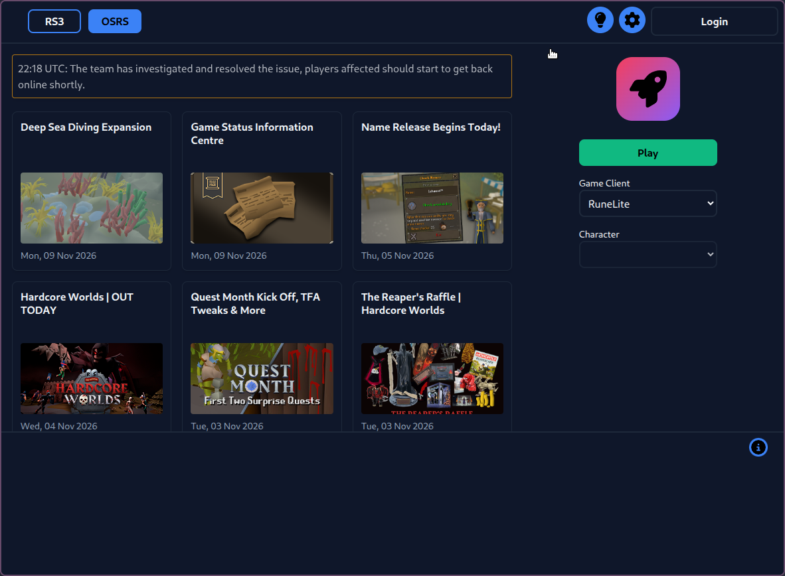

# bolt-runescape-launcher snap

[](https://snapcraft.io/bolt-runescape-launcher)

An **unofficial** snap package of [Bolt](https://codeberg.org/Adamcake/Bolt),
a free-software third-party launcher for RuneScape and Old School RuneScape.

This snap is maintained by Matt Kosarek ([@mattkae](https://github.com/mattkae)).
It is **not** made, endorsed or supported by the Bolt developers.



## Reporting bugs

**Report every problem with the snap here:**
https://github.com/mattkae/bolt-runescape-launcher-snap/issues

Please do **not** contact the Bolt project, its issue tracker or its Discord
about problems you hit while using this snap.

Only report upstream when **all** of the following are true:

1. You built the **same Bolt version** as the snap (see `snap info bolt-runescape-launcher`)
   from source yourself, following
   [Bolt's build instructions](https://codeberg.org/Adamcake/Bolt#building),
   outside of any snap.
2. You reproduced the same problem with that local build.
3. You follow Bolt's own contribution rules.

If you are not sure, open an issue here first.

## Installing

```sh
sudo snap install bolt-runescape-launcher
```

## Known limitations

- Only `amd64` is built.
- `umu-launcher` is not bundled, so the official OSRS client runs on plain Wine.
- Discord rich presence does not work because strict confinement blocks
  access to Discord's IPC socket.
- Data lives in `~/snap/bolt-runescape-launcher/current/`, not `~/.local/share/bolt-launcher`.
  Existing data from a non-snap Bolt install is not migrated.

## Building

```sh
snapcraft pack
sudo snap install --dangerous ./bolt-runescape-launcher_*.snap
sudo snap connect bolt-runescape-launcher:browser-support
sudo snap connect bolt-runescape-launcher:wayland
sudo snap connect bolt-runescape-launcher:joystick   # optional, for controllers
```

## Updating to a new Bolt release

1. Update `version` and the `bolt` part's `source-tag` in `snap/snapcraft.yaml`.
2. If the release needs a new CEF build, update the `cef` part's URL and checksum
   from [adamcake.com/cef](https://adamcake.com/cef). Use the plain Linux tarball,
   not the `-flatpak-` one.
3. Rebuild and test RS3, the official OSRS client, RuneLite and HDOS.

## License

The packaging in this repository is licensed under the GPL-3.0 (see `LICENSE`).
Bolt itself is licensed under the AGPL-3.0.
